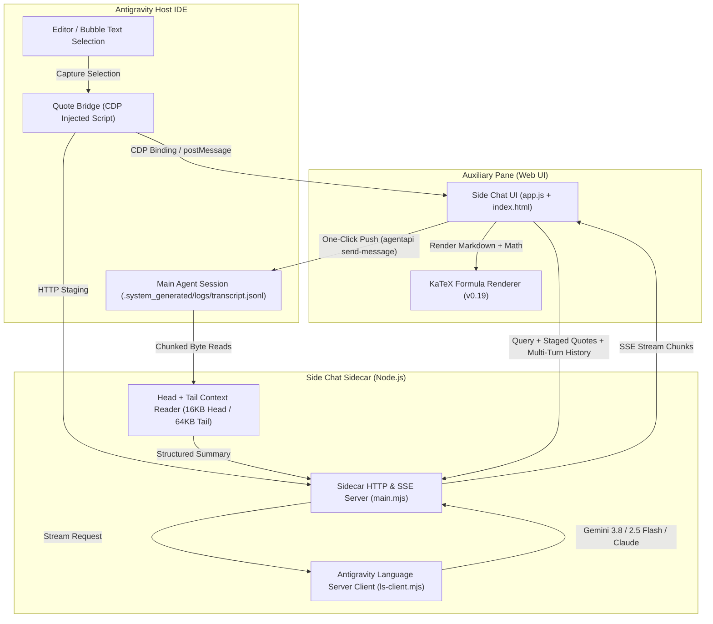

# Antigravity Side Chat (`/btw`)

<p align="center">
  
</p>

<p align="center">
  <b>Claude Code <code>/btw</code>-style lightweight parallel side chat in the Antigravity Auxiliary Pane</b><br />
  Featuring zero context pollution, automatic workspace context awareness, real-time text selection quoting, native LaTeX KaTeX rendering, and one-click push to main agent.
</p>

<p align="center">
  <a href="https://opensource.org/licenses/MIT"></a>
  
  
  
</p>

<p align="center">
  <b>English</b> | <a href="README_CN.md">简体中文</a>
</p>

---

## Overview

When developing alongside an autonomous AI agent in Google Antigravity, you frequently need quick sanity checks, syntax explanations, math formula verifications, or tangential explorations. Asking these directly in the main conversation pollutes the agent's working memory, disrupts planning trajectories, or triggers unwanted tool executions.

**Antigravity Side Chat** brings the beloved **Claude Code `/btw`** experience directly into the **Antigravity Auxiliary Pane**:
- **Zero Context Pollution**: Engage in freeform technical discussions without altering or cluttering the primary agent session.
- **Deep Context Awareness**: Reads the active conversation's initial prompt, root objective, active step count, and latest turns via an ultra-fast Head + Tail reader.
- **Real-Time Selection Quoting**: Select code or text in the editor or conversation bubbles and quote it immediately into Side Chat.
- **Native LaTeX Formula Rendering**: Out-of-the-box KaTeX support for inline (`$E=mc^2$`) and block (`$$\int f(x)dx$$`) math notation with smart backtick/currency escaping.
- **Push-to-Main Handoff**: Promote verified conclusions, architectural decisions, or revised instructions into the main agent's message queue with one click.

---

## Architecture & Data Flow



---

## Complete Feature Breakdown

### 1. Zero Context Pollution
Run parallel inquiries, probe edge cases, explore alternative algorithms, or inspect stack traces without appending turns or tool outputs to your primary agent's context window.

### 2. Global Shortcut: `Shift+Command+S` / `Shift+Ctrl+S`
- Press <kbd>Shift</kbd> + <kbd>⌘ Cmd</kbd> + <kbd>S</kbd> (macOS) or <kbd>Shift</kbd> + <kbd>Ctrl</kbd> + <kbd>S</kbd> (Linux/Windows) anywhere in the editor to immediately toggle/activate the Side Chat tab and autofocus the query input.
- If text is currently highlighted when the shortcut is triggered, it is automatically captured, staged into the quote chip, and cleared from the editor selection.
- Inside the Side Chat iframe, the same shortcut refocuses and selects the input composer.

### 3. Quote Bridge (Host Selection Integration)
- Injects a seamless **"Side Chat"** button into Antigravity's native `.selection-quote-popup`.
- Uses Chrome DevTools Protocol (CDP) runtime bindings (`__agSideChatQuoteBindingV1`) combined with multi-stage `postMessage` delivery (0ms, 120ms, 300ms, 600ms, 1000ms) to guarantee reliable quote arrival even if the tab was suspended.
- Includes fallback activation via tab-bar selectors, card buttons, and React Fiber `onSidecarLinkClick`.

### 4. LaTeX KaTeX Formula Rendering
- Built-in KaTeX 0.19 engine renders inline math `$E=mc^2$` and block math `$$\mathcal{L}_{G} = \mathbb{E}[\log D(x)]$$`.
- **Currency & Backtick Guard**: Smart regex parser ignores financial dollar signs (e.g., `$100`, `$3.50`) and backtick-wrapped identifiers (e.g., `` `$HOME` ``) to prevent false KaTeX rendering errors.
- Theme-adaptive KaTeX stylesheet aligned with Antigravity dark/light themes.

### 5. Multi-Turn Conversational Memory & Reset
- Maintains full multi-turn conversation memory within your current side chat thread.
- Provides a **New Session** button (`#reset-btn`) in the header to instantly reset history and code block state.

### 6. Streaming Abort & `Esc` Shortcut
- Click the streaming stop button or hit <kbd>Esc</kbd> anytime during token generation to immediately cancel active streaming via `AbortController`.

### 7. IME Composition Guard
- Explicitly tracks `compositionstart` and `compositionend` events.
- Prevents accidental premature message submission when converting characters in Chinese (Pinyin), Japanese (Romaji), or Korean (Hangul) input methods.

### 8. Head + Tail Context Reader (`context-reader.mjs`)
- **Head Read (16KB)**: Reads the start of `transcript.jsonl` to reliably extract the session's root objective and initial user request.
- **Tail Read (64KB)**: Reads the tail of `transcript.jsonl` using backward chunk offsets to fetch the latest step index and recent tool/model turns.
- Consumes negligible memory and IO overhead, avoiding the multi-megabyte JSON allocations typical of full transcript parsers.
- Language Server fallback via `GetCascadeTrajectorySteps` when disk transcripts are pending sync.

### 9. Push-to-Main Handoff
- Transfer validated solutions directly to the primary agent session:
  - **Direct Push**: Sends the side chat insight straight into the main task queue.
  - **Push with Note**: Attach explicit instructions or constraints (e.g., *"Adopt this BFS implementation for step 4"*).
  - Powered by local `agentapi send-message` CLI integration.

---

## Directory Structure

```
antigravity-side-chat/
├── plugin.json                 # Antigravity plugin manifest
├── package.json                # Project & package metadata
├── LICENSE                     # MIT License
├── .gitignore                  # Git ignore rules
├── README.md                   # English documentation (this file)
├── README_CN.md                # 简体中文完整文档
├── assets/
│   └── logo.svg                # 128x128 vector badge
├── skills/
│   └── btw/
│       └── SKILL.md            # /btw skill definition & aux pane deep link
└── sidecars/
    └── panel/
        ├── sidecar.json        # Sidecar specification for Auxiliary Pane
        ├── main.mjs            # Sidecar HTTP server & SSE streaming dispatcher
        ├── ls-client.mjs       # Antigravity Language Server client & model manager
        ├── context-reader.mjs  # Fast Head + Tail transcript parser
        ├── quote-bridge.mjs    # CDP host renderer selection quote bridge
        ├── index.html          # Web UI layout & dialogs
        ├── styles.css          # Design system stylesheet
        ├── app.js              # Frontend controller, IME guard & KaTeX pipeline
        ├── katex.min.js        # KaTeX math engine (0.19.0)
        └── katex.min.css       # KaTeX web styles
```

---

## Installation Guide

### Method 1: Global Plugin Installation (Recommended)

1. Clone or symlink this repository into your user plugin configuration directory:
   ```bash
   # Clone repository
   git clone https://github.com/yiwen-cai/antigravity-side-chat.git ~/.gemini/config/plugins/side-chat

   # Or symlink an existing local clone
   ln -s "$(pwd)" ~/.gemini/config/plugins/side-chat
   ```

2. Restart or reload Antigravity.

3. Verify installation:
   - Type `/btw` in the main chat to trigger the skill.
   - Or open the Auxiliary Pane and click **Side Chat (/btw)**.

### Method 2: Workspace-Level Plugin Installation

Place this repository inside your workspace's `.gemini/plugins/` directory:
```bash
mkdir -p <workspace>/.gemini/plugins
ln -s /path/to/antigravity-side-chat <workspace>/.gemini/plugins/side-chat
```

---

## Standalone Development & Debugging

The sidecar server is built to run both as an embedded Antigravity sidecar and as a standalone Node.js process for rapid UI iteration:

```bash
cd sidecars/panel
SIDE_CHAT_PORT=17895 node main.mjs
```

Open `http://127.0.0.1:17895` in your browser.

### API Endpoints Reference

| Method | Endpoint | Description |
|---|---|---|
| `GET` | `/` | Web UI entry point (`index.html`) |
| `GET` | `/styles.css` | UI stylesheet |
| `GET` | `/app.js` | Frontend controller & client logic |
| `GET` | `/katex.min.css` | KaTeX formula stylesheet |
| `GET` | `/katex.min.js` | KaTeX formula rendering library |
| `GET` | `/api/models` | Available LLM models with quota remaining & families |
| `GET` | `/api/context` | Returns parsed main conversation context & staged quotes |
| `POST` | `/api/quote` | Stages a quoted text snippet from selection |
| `POST` | `/api/quote/clear` | Clears currently active quote snippet |
| `POST` | `/api/ask` | Unary question answering using Gemini Flash |
| `POST` | `/api/ask/stream` | Server-Sent Events (SSE) token streaming |
| `GET` | `/api/events` | SSE event stream for real-time quote synchronization |
| `POST` | `/api/push-to-main` | Submits message/note into the primary agent session |

---

## Contributing

Pull requests and issues are welcome! Please ensure:
1. All changes maintain minimal dependencies (Node.js built-ins and zero unnecessary npm packages).
2. Existing keyboard shortcuts, IME handlers, and CDP quote bridge hooks remain fully functional.
3. Code comments follow clean technical standards.

---

## License

This project is licensed under the [MIT License](LICENSE) &copy; 2026 Yiwen Cai.
