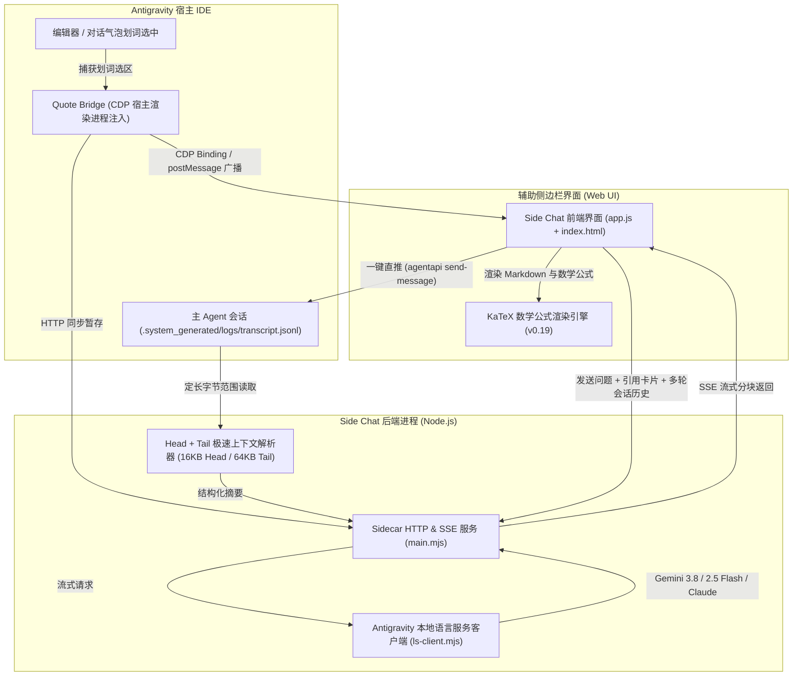

# Antigravity 辅助栏轻量并行侧聊插件 (`/btw`)

<p align="center">
  
</p>

<p align="center">
  <b>Google Antigravity 辅助侧边栏（Auxiliary Pane）中的 Claude Code <code>/btw</code> 风格轻量并行侧聊插件</b><br />
  零上下文污染 · 自动感知主任务上下文 · 划词选中文本自动引用 · 原生 LaTeX KaTeX 公式渲染 · 一键直推主 Agent
</p>

<p align="center">
  <a href="https://opensource.org/licenses/MIT"></a>
  
  
  
</p>

<p align="center">
  <a href="README.md">English</a> | <b>简体中文</b>
</p>

---

## 插件概述

在与自主 AI Agent 协作编程时，开发者经常需要快速验证技术细节、查询语法、推导数学公式或探索备选方案。如果直接在主对话中提问，不仅会膨胀主 Agent 的上下文窗口、污染规划轨迹，还可能触发不必要的工具调用或打断正在执行的长任务。

**Antigravity Side Chat** 将深受喜爱的 **Claude Code `/btw`** 体验引入到了 **Antigravity Auxiliary Pane（辅助侧边栏）**：
- **零上下文污染**：独立侧聊线程，随心讨论与验证，完全不影响主任务的 Context 与轨迹。
- **全局快捷唤醒**：`Shift+Command+S`（macOS）/ `Shift+Ctrl+S`（Windows/Linux）一键激活辅助栏并聚焦输入框。
- **智能主任务感知**：自研 Head + Tail 极速日志读取器，秒级掌握主会话的初始目标、当前步骤进度与最近模型轮次。
- **划词引用（Quote Bridge）**：在代码编辑器或对话气泡中划选文本，实时自动填入引用卡片。
- **原生 KaTeX 数学排版**：全面支持行内 `$E=mc^2$` 与行间 `$$\sum_{i=1}^n x_i$$` 公式渲染，内置货币符号与反引号防误判机制。
- **一键直推主任务（Push-to-Main）**：在侧聊中梳理好结论或修正方案后，点击即可直接或附言推送到主 Agent 消息队列中。

---

## 架构与数据流



---

## 核心特性深度解析

### 1. 零上下文污染（Zero Context Pollution）
随时与低延迟大模型（Gemini 3.8 / 2.5 Flash）就代码实现细节、正则语法、算法复杂度进行发散性探讨，绝不往主会话历史中追加冗余轮次，为主 Agent 节省宝贵的上下文空间。

### 2. 全局快捷键：`Shift+Command+S` / `Shift+Ctrl+S`
- 在 IDE 编辑器或窗口任意位置按下 <kbd>Shift</kbd> + <kbd>⌘ Cmd</kbd> + <kbd>S</kbd>（macOS）或 <kbd>Shift</kbd> + <kbd>Ctrl</kbd> + <kbd>S</kbd>（Windows/Linux）：
  - 自动展开辅助侧边栏并切换到 Side Chat 选项卡。
  - 自动聚焦到底部提问输入框。
  - 若此时在编辑器中高亮选中文本，快捷键会同步**捕获选中内容填入引用暂存区**并取消选区高亮。
- 在 Side Chat iframe 内部按下该快捷键，同样支持快速聚焦并全选输入框。

### 3. Quote Bridge（划词引用桥接器）
- 通过 Chrome DevTools Protocol (CDP) 注入到宿主渲染进程，拦截原生 `.selection-quote-popup` 气泡，原生内嵌「Side Chat」操作按钮。
- 结合 CDP 运行时绑定（`__agSideChatQuoteBindingV1`）与阶梯式多阶段 `postMessage` 派发（0ms, 120ms, 300ms, 600ms, 1000ms），彻底解决 Tab 挂起或 iframe 尚未就绪时的消息丢失问题。
- 内置选项卡点击激活、卡片点击以及 React Fiber `onSidecarLinkClick` 三层兜底激活方案。

### 4. LaTeX KaTeX 原生公式渲染
- 原生搭载 KaTeX 0.19.0 引擎，支持行内公式 `$E=mc^2$` 与块级公式：
  $$\int_{-\infty}^{+\infty} e^{-x^2} dx = \sqrt{\pi}$$
- **防误判规则引擎**：精准过滤金额数字（如 `$100`, `$3.50`）和代码内反引号变量（如 `` `$HOME` ``），杜绝公式误解析。
- 配套深色与浅色自适应主题样式。

### 5. 多轮会话记忆与一键重置
- 侧聊支持完整的连续多轮上下文追踪，便于层层递进讨论技术方案。
- 顶部导航栏提供一键「新会话（New Session）」重置按钮，随时清空侧聊历史并复位代码块索引。

### 6. 流式生成中断与 `Esc` 快捷键
- 模型流式输出过程中，底部发送按钮自动切换为「停止生成（Stop）」状态，支持随时点击中断。
- 在页面任意位置按下 <kbd>Esc</kbd> 键同样触发即时中断（基于 `AbortController` 信号）。

### 7. 中文/日文输入法合成保护（IME Composition Guard）
- 细致监听 `compositionstart` 与 `compositionend` 事件状态。
- 在使用中文拼音、五笔或日文假名选词按回车确认时，坚决拦截表单过早提交，彻底告别误发残缺句子的糟糕体验。

### 8. Head + Tail 极速上下文阅读器（`context-reader.mjs`）
- **头部读取（16KB）**：精准提取 `transcript.jsonl` 的初始 User Request 和全局目标。
- **尾部倒序读取（64KB）**：仅读取日志末尾字节分块，毫秒级提取最大 Step Index 与最近的 Planner 动作和模型回复。
- 避免传统读取方式每次反序列化数十兆全量日志的内存抖动和卡顿；当磁盘日志尚未刷新时，自动回退到语言服务 `GetCascadeTrajectorySteps` 接口。

### 9. 主任务一键直推（Push-to-Main）
- **直接插入**：将侧聊沉淀的代码或建议原样插入主 Agent 的队列中。
- **附言后插入**：附加具体的执行指令（例如：*“请参考上述逻辑重构第 3 步中的树遍历”*）。
- 基于底层 `agentapi send-message` CLI 优雅衔接，主智能体收到后无缝继续推进。

---

## 目录结构

```
antigravity-side-chat/
├── plugin.json                 # Antigravity 插件配置清单
├── package.json                # 项目元数据与依赖定义
├── LICENSE                     # MIT 开源授权协议
├── .gitignore                  # Git 忽略配置
├── README.md                   # 英文说明文档
├── README_CN.md                # 简体中文说明文档（本文档）
├── assets/
│   └── logo.svg                # 128x128 矢量高对比度图标
├── skills/
│   └── btw/
│       └── SKILL.md            # /btw 技能定义与辅助栏直达链接
└── sidecars/
    └── panel/
        ├── sidecar.json        # 辅助侧边栏 Sidecar 配置
        ├── main.mjs            # Sidecar 服务端（HTTP & SSE 广播）
        ├── ls-client.mjs       # Antigravity 语言服务客户端与模型管理
        ├── context-reader.mjs  # Head + Tail 极速日志解析引擎
        ├── quote-bridge.mjs    # CDP 宿主划词引用桥接器
        ├── index.html          # Web UI 界面结构
        ├── styles.css          # 自适应设计系统样式表
        ├── app.js              # 前端业务逻辑、IME 守卫与 KaTeX 渲染
        ├── katex.min.js        # KaTeX 数学公式渲染库 (0.19.0)
        └── katex.min.css       # KaTeX 样式表
```

---

## 安装与配置指南

### 方式一：全局用户插件安装（推荐）

1. 克隆或软链接本仓库到用户插件目录：
   ```bash
   # 克隆仓库
   git clone https://github.com/yiwen-cai/antigravity-side-chat.git ~/.gemini/config/plugins/side-chat

   # 或通过软链接链接当前本地仓库
   ln -s "$(pwd)" ~/.gemini/config/plugins/side-chat
   ```

2. 重启或重新加载 Antigravity。

3. 验证功能：
   - 在主对话框输入 `/btw` 触发技能。
   - 或点击辅助侧边栏中的 **Side Chat (/btw)** 选项卡。

### 方式二：工作区级别插件安装

将本仓库放置到工作区目录的 `.gemini/plugins/` 下：
```bash
mkdir -p <workspace>/.gemini/plugins
ln -s /path/to/antigravity-side-chat <workspace>/.gemini/plugins/side-chat
```

---

## 本地独立预览与调试

Sidecar 服务端内置双模驱动机制：在 Antigravity 容器内由 `sidecar_sdk` 托管；在本地调试时可直接脱离宿主独立运行：

```bash
cd sidecars/panel
SIDE_CHAT_PORT=17895 node main.mjs
```

在浏览器中打开 `http://127.0.0.1:17895` 即可实时预览 UI、测试接口并热重载样式。

### 后端 API 接口参考

| 方法 | 请求路径 | 接口描述 |
|---|---|---|
| `GET` | `/` | Web UI 主入口页面 (`index.html`) |
| `GET` | `/styles.css` | UI 核心样式表 |
| `GET` | `/app.js` | 前端控制器与核心逻辑 |
| `GET` | `/katex.min.css` | KaTeX 公式排版样式 |
| `GET` | `/katex.min.js` | KaTeX 公式渲染核心引擎 |
| `GET` | `/api/models` | 获取可用模型列表、剩余配额与模型家族分类 |
| `GET` | `/api/context` | 获取主任务解析摘要及当前暂存的引用卡片 |
| `POST` | `/api/quote` | 手动暂存划词选中文本片段 |
| `POST` | `/api/quote/clear` | 清空当前暂存的引用内容 |
| `POST` | `/api/ask` | 单次问答接口（返回完整回答） |
| `POST` | `/api/ask/stream` | Server-Sent Events (SSE) 流式返回生成 Token |
| `GET` | `/api/events` | SSE 事件流通道（用于向前端实时广播宿主划词事件） |
| `POST` | `/api/push-to-main` | 将当前建议/附言推送到主 Agent 会话队列 |

---

## 贡献规范

欢迎提交 Issue 与 Pull Request！提交代码时请遵循：
1. **轻量零无谓依赖**：保持核心逻辑使用 Node.js 原生 API，避免引入体积庞大的第三方依赖包。
2. **行为兼容性保证**：确保全局快捷键、IME 输入法保护、CDP 桥接器与 KaTeX 渲染管道正常运作。
3. **清晰的提交记录**：遵循语义化提交规范（如 `feat:`, `fix:`, `docs:`）。

---

## 开源协议

本项目基于 [MIT 协议](LICENSE) 开源 &copy; 2026 Yiwen Cai。
